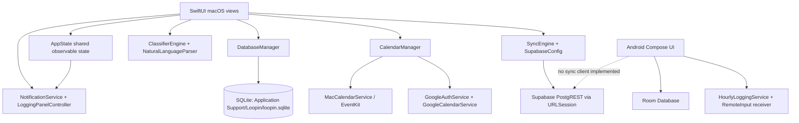

# Logtrackin — Complete Technical Project Analysis and Implementation Guide

> **Repository reviewed:** `Logtrackin` (Swift package + Android Gradle project)  
> **Review date:** 10 November 2026  
> **Purpose:** document the code that exists, explain how the app works, call out material mismatches and risks, and give a concrete implementation sequence for completing and hardening the product.

## 1. Executive overview

Logtrackin is a native macOS time-logging and planning app with an Android companion. The macOS client is a Swift 6 package using SwiftUI, AppKit, SQLite3, EventKit, UserNotifications, Speech, and URLSession. The Android client is Kotlin/Jetpack Compose with Room and a foreground notification service. The macOS app has the broadest feature set: calendar, week planner, planned/logged rails, classification, analytics, focus tools, account/settings, local Apple Calendar access, Google Calendar API calls, and a Supabase REST sync engine.

The project has substantial implemented functionality, but the specifications and actual code diverge. In particular, the week planner uses SwiftUI `DragGesture` rather than the AppKit interaction layer prescribed in `PRD_v2.md`; resize and move interactions are not wired in the inspected DayColumn implementation; the main window minimum width is 1060 points in `WindowAccessor` while the root view says 980; calendar sync is not full bidirectional sync; several visible voice controls insert fixed demo text; and Android has no Supabase or Google integration despite a status pill that says they are connected. Treat the roadmap in the repository as an intention, not a statement that every item is complete.

## 2. Repository inventory

### Top-level files and directories

| Path | Role |
|---|---|
| `Package.swift` | Swift Package Manager definition; macOS 14 minimum; `Loopin` executable and `LoopinTests` test target; no external Swift package dependencies. |
| `build_app.sh` | Builds release executable and wraps it in `Logtrackin.app` with an Info.plist and app icon. |
| `README.md` | Product overview, claimed feature set, architecture and user build instructions. Some claims exceed what is wired into the code. |
| `PRD_v2.md` | Native rebuild requirements and interaction specifications. |
| `IMPLEMENTATION_PLAN_v2.md` | Phase-based original build plan and verification goals. |
| `PHASE_10_PLUS_SPEC.md` | Proposed backend, sync, calendar and Android expansion plan. |
| `Sources/Loopin/App` | App lifecycle, shared state, native menu bar, window configuration. |
| `Sources/Loopin/Models` | Timesheet, category, rules, calendar events, todos. |
| `Sources/Loopin/Database` | SQLite manager and sample data. |
| `Sources/Loopin/Services` | Parsing, classification, prompts, notifications, speech, calendar, cloud sync, todos, sound. |
| `Sources/Loopin/Views` | SwiftUI screens grouped by product area. |
| `Tests/LoopinTests` | Swift tests for analytics, calendar, database, Google payload, parser, quiet hours, sync and todos. |
| `android/` | Android Gradle project, Compose app, Room models/DAOs, notification foreground service and receiver. |
| `assets/` | Logo and macOS icon artwork. |
| `scripts/generate_icon.swift` | Icon generation helper. |
| `Logtrackin.app/` | Existing app bundle in the repository; rebuild it through the script when source changes. |

The project has no checked-in `AGENTS.md` in its root or source tree. `.build/` is generated SwiftPM state and should not be treated as authored implementation.

## 3. Architecture at a glance



There is no shared cross-platform code layer. macOS and Android duplicate model concepts and classifier behavior in Swift and Kotlin. The cloud connection is macOS-only in the current source.

## 4. macOS application startup and window lifecycle

1. `LoopinApp` declares a SwiftUI `Window` titled “Logtrackin”, default size 1180×760, and app commands.
2. `AppDelegate.applicationDidFinishLaunching` sets regular activation policy, loads the Dock icon, installs the menu-bar item and requests notification authorization.
3. `ContentView` builds a left sidebar and switches the main screen based on `AppState.selectedTab`.
4. On appearance, `SampleDataSeeder.seedDefaultRulesIfNeeded()` inserts starter classifier rules when the rule table is empty.
5. `WindowAccessor` obtains the hosting `NSWindow`, sets transparent titlebar/full-size content, style mask, appearance, pin level, background dragging behavior and minimum size.
6. Changes to `AppState.showFloatingLoggingPanel` open/close the reusable `LoggingPanelController` panel.

### Window behavior findings

- Window background dragging is explicitly disabled; a separate `WindowDragArea` can make selected views movable.
- `WindowAccessor.configureWindow` sets minimum size to **1060×680**, which conflicts with the 980×640 requirement in the PRD and the root SwiftUI frame constraint.
- `TabBarView` exists, but `ContentView` uses `SidebarView`; the tab-bar file should not be mistaken for the active shell.
- Pinning sets the main window level to `.floating`; normal is the default.
- The logging panel is an `NSPanel`, configured to float over Spaces/full-screen apps and not hide on deactivation. Its level is `.screenSaver`, which is more elevated than the specification’s `.floating` and should be reviewed for expected focus/privacy behavior.
- The app is named `Loopin` as the Swift executable/product and `Logtrackin` as the UI/bundle name. That distinction is intentional in code but affects commands, process naming and packaging.

## 5. Core data model and persistence

### Timesheet entry

`TimesheetEntry` is a Codable, Equatable, Sendable value model with:

- `id` string (UUID by default)
- `kind`: `planned` or `logged`
- `startAt`, `endAt`
- `rawText`
- `inputMethod`: typed, voice or skipped
- optional category, subcategory, productivity
- optional Google Calendar event ID
- device ID, sync flag, updated timestamp
- duration and formatted display helpers

`ProductivityType` has productive, wasteful and legacy neutral; display logic maps neutral to non-productive. `ClassificationRule` stores a phrase, category, optional subcategory, productivity string and update timestamp.

### SQLite implementation

`DatabaseManager` opens `~/Library/Application Support/Loopin/loopin.sqlite` using the system `SQLite3` C API. It serializes database work through a private dispatch queue, creates tables and indexes, and posts `DatabaseManager.didChangeNotification` after writes so views can reload.

Tables:

- `timesheet_entries`: IDs, kind, start/end epoch values, raw text, input method, category/subcategory/productivity, Google event ID, device ID, sync flag, updated timestamp.
- `classification_rules`: ID, unique phrase, category/subcategory/productivity and update timestamp.

CRUD helpers include insert/update/delete, fetch by ID, all entries, pending-sync entries, day/week/range queries, rule CRUD and clear-all. The range query includes entries that overlap a requested range, including entries that begin before and end after it.

### Persistence caveats to resolve

1. **SQLite errors are mostly printed, not surfaced.** UI calls cannot reliably report failed writes to the user.
2. **Schema changes are opportunistic `ALTER TABLE` calls.** There is no `user_version`-based ordered migration history, and migration return values are ignored.
3. **Startup migrations mutate user data.** Current code converts neutral/null productivity to wasteful, removes skipped rows, deletes one phrase pattern, and reclassifies certain terms. These are product rules embedded in database startup and need explicit migration/versioning and review.
4. **No foreign keys or transactions** join entries to rules, calendars or cloud state.
5. `clearAllData()` clears entries and rules, but does not erase todos, user preferences, calendar data, or remote copies.
6. Rule updates use `INSERT OR REPLACE` keyed by phrase uniqueness, which can replace a different row ID; UI identity/state should be checked when editing a phrase.

## 6. Classification and natural-language planning

### Classification path

`ClassifierEngine.classify(text:rules:)` checks, in order:

1. User rules sorted by descending phrase length.
2. Built-in taxonomy sorted by descending phrase length.
3. A list of nonproductive keywords and category heuristics.
4. Productive work keywords.
5. Default: “Personal / Uncategorized”, wasteful.

Matching combines substring matching and a regular-expression word-token check. `learnRule` saves the full normalized input phrase as a new rule. Entry editing, logging-panel entry, quick-plan, calendar event conversion and classification screens may each apply different classification/persistence paths; establish one shared service entry point before adding features.

### Natural language parser

`NaturalLanguageParser` recognizes explicit time ranges such as `coding 2-4pm`, `meeting 10am to 11am`, and `design 14:00-16:00`; it also handles a single explicit AM/PM time as a one-hour block. If no supported time is present, it uses a rounded current-time start and one-hour duration. The parsed time range is removed from the task title.

Known boundaries: parser is regex-based, does not resolve dates such as “tomorrow”, has limited 24-hour handling, and can infer an end as one hour later when a range is invalid/ambiguous. Validate midnight, noon, overnight, malformed times, locale and daylight-saving cases before relying on it for scheduling.

## 7. Product screens and actual behavior

### Sidebar and shell

`SidebarView` exposes Calendar, Week Planner, Timesheet Rails, Analytics & Reports, Dictionary & Rules, Focus & Pomodoro, Account & Cloud, and Settings. It includes new-entry actions, theme selection, a compact/collapsed state and pin controls. `ContentView` maps each tab to its screen. The global New Entry sheet uses `EntryEditorPopover`.

### Calendar

`CalendarView`, `MonthCalendarGrid`, `YearCalendarGrid`, and `CalendarSidebarDrawer` provide day/week/month/year mode selection, navigation, event selection/editing, date range selection and calendar visibility controls. `CalendarManager` merges local timesheet entries, app-created events, Google events, Mac Calendar events and generated Indian holiday events. Custom calendar events are stored as JSON in `UserDefaults`, not in SQLite. EventKit permission and fetch behavior live in `MacCalendarService`; holiday normalization/deduplication is also handled there.

### Week Planner

`WeekCalendarView` lays out week headers, time gutter and seven `DayColumnView`s; fetches a week of entries; navigates weeks; edits entries; and creates entries from a drag range. `DayColumnView` uses a SwiftUI `DragGesture`, draws half-hour gridlines, entries, overlap columns, selection preview and a now-line. The visible implementation updates entry time through a callback, but the inspected gesture implementation attaches to the blank grid and does not provide the PRD’s precise AppKit hit-zone resize/move behavior. The column widths are computed from a minimum width floor and displayed in a vertical scroll view, not the PRD’s stated two-axis scroll arrangement. Cross-midnight entries and entries spanning dates should be verified in rendering and editing.

### Timesheet Rails

`RailsView` loads today’s database entries and combines summary cards, `QuickPlanInputView`, `IntervalBannerView`, planned/logged rail visualization and `TodayBlocksListView`. Quick plan uses the parser and classifier, then inserts a planned row. The list supports entry edit/delete and can add sample entries. Review whether adding sample data is intended in a production build.

### Analytics

`AnalyticsView` aggregates logged entries by timeframe and displays totals, focus/productivity stats, category distribution and stacked productivity charts. Helpers live in `CategoryBarChart` and `ProductivityStackedBar`. The screen calculates from local entries; test edge cases such as overlapping blocks, neutral legacy rows and entries crossing timeframe boundaries (current duration sums may count whole entries rather than clip to the selected interval).

### Dictionary and rules

`DictionaryView` and `RuleEditorSheet` list, filter, add, edit and delete classification rules. Database change notifications refresh connected views. Confirm category/productivity consistency with classifier built-ins and rule-phrase identity when the phrase is edited.

### Settings and focus prompts

`SettingsView` handles appearance/theme, clock format, week start, prompt interval, quiet hours, Pomodoro settings and data export. `FocusSettingsView` includes quiet-hours controls, Pomodoro, Supabase config/status/actions, Google Calendar controls, sound and database operations. `PomodoroView` supplies timer setup/controls. `AppState` runs a one-second Combine timer for the interval countdown and Pomodoro countdown. When configured for a 60-minute interval, it aligns to the wall-clock hour; other interval values are free-running.

### Floating logging panel

`LoggingPanel` subclasses `NSPanel`; `LoggingPanelController` creates and positions it. `LoggingPanelContentView` supports text, category chips, submit and skip, and writes a logged entry using the selected prompt interval. Skip currently dismisses without inserting a skipped row, consistent with a database migration that deletes skipped entries. Voice is **not real in this view**: `toggleVoiceInput()` inserts a hard-coded phrase. The panel also uses a category selection to learn a full-input phrase rule.

### Account, history and export

`AccountView` and `HistorySheetView` expose profile/account state, entry history, Google account controls and setup guides. The app stores profile/token values in `UserDefaults`; inspect and replace this with Keychain before distributing. Settings export is described in UI/README as JSON/CSV copied to clipboard; ensure export paths and fields are consistent and safe for large datasets.

### Menu bar, tutorial, focus timer and sticky to-do

- `MenuBarManager`: menu-bar timer icon, manual prompt, main-window reveal, Pomodoro/focus timer, sticky to-do, tutorial and quit.
- `FocusTimerWindowController` + `FocusTimerView`: standalone Pomodoro/countdown/stopwatch-style focus window.
- `StickyTodoWindowController` + `StickyTodoView` + `TodoStore`: persistent todo panel, order/completion/star/filter/theme and clipboard summary. Todo data is JSON in `UserDefaults`; first launch seeds example tasks.
- `TutorialWindowController` + `TutorialGuideView`: in-app usage guide.
- `SoundManager` and reusable modifiers: click/success sound, breathing glow, ripple and ambient glow effects.

## 8. Notifications, timing, quiet hours and speech

`AppState` ticks once per second. On a prompt, it formats the interval, posts a native user notification, checks quiet hours, optionally beeps and opens the floating panel. Quiet-hour range logic handles overnight windows. `LoggingScheduler` wraps the same shared state and has a static quiet-hour calculation used by tests, but its published values duplicate the AppState values; keep a single settings source to avoid drift.

`NotificationService` registers Log Now/Skip actions. The action handler maps notification interaction to logging or dismissal. `SpeechRecognizerService` uses `SFSpeechRecognizer` and `AVAudioEngine`, but its error/unavailable branches also return a hard-coded phrase, which can make failed recognition look successful. A permission/availability state should be displayed to the user instead.

Important timing issue: in wall-clock aligned mode, prompt interval is built as the previous whole hour even if a non-hour app start or sleep/wake caused missed timer ticks. Exercise app sleep, resume, timezone change and manual test prompt behavior. Quiet hours are checked when prompting, not when scheduling.

## 9. Google Calendar integration

`GoogleAuthService` constructs a Google OAuth URL, opens the system browser, verifies an access token against userinfo, and fetches calendar list. `GoogleCalendarConfig` stores client/token/calendar IDs in `UserDefaults`. `GoogleCalendarService` serializes events, pushes a create/update request to a planned/logged calendar ID (or `primary`) and fetches event ranges. `CalendarManager` triggers Mac Calendar fetch, pushes entries with no Google event ID and fetches Google events.

This is not yet a robust two-way sync implementation:

- OAuth uses implicit `response_type=token`, a fixed loopback HTTPS redirect and no visible PKCE/state/refresh flow. Tokens are stored unencrypted in UserDefaults.
- Calendar-list code finds existing Loopin calendars but does not create/provision missing calendars in the inspected path.
- `syncAll()` pushes entries without a Google event ID; it does not consistently update already-linked entries after local edits or propagate deletions.
- Pull is represented as CalendarEvent data, not a complete reconciliation into local timesheet rows; the calendar fetch path focuses on the planned calendar ID.
- No Google sync token/delta cursor or retry queue is present.
- `CalendarManager` starts a sync task during initialization and has UI-triggered sync; verify duplicate/racing requests.

Implement OAuth and event synchronization as a separately reviewed subsystem before claiming two-way semantics.

## 10. Supabase sync

`SupabaseConfig` persists project URL, anonymous key, email, token and auto-sync switch in `UserDefaults`. `SyncEngine` uses URLSession/PostgREST:

1. Reads local rows with `is_synced = 0`.
2. POSTs JSON to `timesheet_entries` with merge-duplicates preference.
3. Marks all posted IDs synced locally.
4. GETs up to 100 remote rows ordered by update time.
5. Inserts remote rows or replaces a local row only when remote `updatedAt` is newer.

The UI can start periodic syncing from Focus & Prompts and request a manual sync. Review these correctness/security gaps before production:

- No authenticated user ID is attached to payload in the shown implementation, while the phase spec’s schema requires `user_id`; RLS and table schema must match the actual payload.
- Marking rows synced happens after `pushEntriesToSupabase` succeeds at HTTP level, but not per-row; validate server-side upsert semantics and returned statuses.
- Deletions are not represented in a sync tombstone queue.
- Pull is capped at 100 and has no pagination/cursor, so older rows can be missed.
- Remote changes are not compared against a durable last-sync watermark and realtime subscriptions are not implemented.
- Auto-sync only runs when explicitly started; verify app lifecycle starts/stops it.
- Tokens/keys are held in UserDefaults; use Keychain for user tokens and keep service-role secrets out of clients.
- Supabase rules are not synced in the shown engine.

## 11. Android implementation

### Current stack

- Gradle Android application plugin 8.3.2, Kotlin 1.9.23, KSP 1.9.23.
- Compile/target SDK 34, min SDK 26, Java/Kotlin 17.
- Jetpack Compose/Material 3 UI.
- Room 2.6.1 database `loopin_android.db` with timesheet and classification-rule entities/DAOs.
- Coroutines for database work.
- `HourlyLoggingService` foreground service creates an ongoing high-priority notification with inline `RemoteInput` and Skip.
- `NotificationActionReceiver` classifies and writes one-hour logged rows; Skip writes nothing.

### Android flow and limitations

`MainActivity` opens Room and renders a logged/planned segmented list, quick-log dialog and notification-service toggle. `ClassifierEngine.kt` performs local classification. The receiver handles typed response and skip. Current app dependencies do not include Supabase, Google Calendar, WorkManager, speech recognition, or Glance widgets. The shown “SUPABASE & GCAL CONNECTED” pill is static and misleading; replace with truthful offline/not connected status until those integrations exist.

The foreground service currently starts the notification immediately and returns `START_STICKY`; it does not schedule hourly repetition. The shown service’s start/stop action constants should be checked against `MainActivity` because their use may not align. Manifest declares notification, audio, boot and foreground permissions, but the receiver shown does not implement boot rescheduling. There is no migration strategy beyond Room version 1. The Android quick entry path uses the previous hour for both planned/logged entries, so planned scheduling does not yet use the macOS parser semantics.

## 12. Build, run and package

### macOS

Prerequisites: macOS 14+, Xcode command-line tools/Xcode with Swift 6 toolchain. From the repository root:

```bash
swift build
swift run
swift test
./build_app.sh
open Logtrackin.app
```

`build_app.sh` does a release build, creates `Logtrackin.app/Contents`, copies `AppIcon.icns`, copies the `Loopin` executable as `Contents/MacOS/Logtrackin`, sets executable mode and writes a minimal Info.plist. For real distribution, add stable version/build management, code signing, hardened runtime, notarization, privacy usage strings, sandbox/entitlement decisions and a reproducible archive. The script currently deletes the existing bundle before rebuilding it.

### Android

Open `android/` in Android Studio with a compatible JDK 17 / Android SDK 34 toolchain. Build/install using the Gradle wrapper if present; no wrapper files appeared in the reviewed inventory, so generate/commit the wrapper or use Android Studio. Grant notification permission on Android 13+ and test foreground-service requirements on each target OS version. Build an APK/AAB only after the service lifecycle and permissions have been verified on device.

### Runtime permissions

macOS needs notification, speech recognition, microphone and Calendar permission descriptions/settings. `build_app.sh` includes several Info.plist descriptions, but verify the final packaged bundle and privacy strings against the APIs actually invoked. Android runtime notification/microphone permissions need explicit user flows; manifest declarations alone do not grant runtime permissions.

## 13. Exact recommended implementation process

This sequence prioritizes data safety, truthfulness, and core workflows before expanding integrations.

### Phase A — establish a reproducible baseline

1. Confirm a clean working tree and record current commit/build artifacts.
2. Build macOS debug and release configurations; run existing Swift tests on supported macOS.
3. Build Android debug APK from Android Studio/Gradle and capture compiler/lint findings.
4. Run the app and record each screen, permission prompt, persistence path and interaction; distinguish expected behavior from the README.
5. Add a concise actual-vs-spec matrix to repository documentation and keep this analysis aligned as implementation evolves.

**Exit:** both clients build; all existing tests have known pass/fail results; a screen inventory and reproducible run instructions exist.

### Phase B — make local data safe and observable

1. Introduce a versioned SQLite migration table using `PRAGMA user_version` or a migrations ledger. Never run broad data correction as an unversioned startup side effect.
2. Back up an existing database before migrations; add rollback/recovery messaging.
3. Wrap SQLite operations in explicit transactions where a feature writes related records; surface errors through typed results.
4. Add invariant validation: `endAt > startAt`, recognized kind/input method/productivity, nonempty IDs/text policy, timestamp and maximum duration rules.
5. Add indexes for frequently queried date ranges, kinds and sync status; verify query plans on representative data.
6. Define deletion/tombstone semantics for future cloud sync.
7. Decide whether todos, calendar events and preferences belong in SQLite, JSON files or `UserDefaults`; document export/backup coverage.
8. Move secrets/tokens from `UserDefaults` into Keychain on macOS; add a migration that removes plaintext copies only after successful secure storage.

**Exit:** versioned migration tests preserve representative user data; failed writes appear as actionable UI errors; backup/restore path is documented.

### Phase C — unify entry creation and classification

1. Create an `EntryService` (or equivalent) that accepts source, kind, text, optional time/category and returns a validated classified entry.
2. Route quick plan, logging panel, week grid, global New Entry, notifications, calendar conversions and Android local entry through matching rules.
3. Define whether planned and logged entries both auto-classify; make edit/reclassification consistently update an explicit rule without accidentally learning unwanted full sentences.
4. Add classifier precedence tests: longest user phrase, exact word boundaries, overlap with built-ins, accents/punctuation, empty input, unknown input.
5. Replace simulated voice strings with real recognizer state: permission denied, unavailable, recording, transcript, failure and retry. Never silently submit a fake transcript.
6. Harden parser with date phrases/time-zone handling, AM/PM inference, noon/midnight, overnight, date rollover and invalid-time feedback.

**Exit:** every entry creation path produces the same schema and classification behavior; UI distinguishes parse/voice errors from success.

### Phase D — complete and verify macOS core interactions

1. Pick and enforce one window minimum size (resolve 980×640 vs. 1060×680) in both SwiftUI and AppKit.
2. Confirm titlebar, traffic lights, background-drag disable, pinning and full-screen behavior on macOS 14 and current macOS.
3. Implement week grid as an explicit interaction state machine: empty-grid create, entry selection, body move, top/bottom resize, cancel, keyboard access, snapping and cross-day movement. Use the `NSViewRepresentable` if needed to satisfy precise pointer capture; otherwise demonstrate the SwiftUI implementation passes the exact interaction criteria.
4. Make the canvas horizontally scrollable or otherwise verify all seven columns at the declared minimum size; keep time gutter alignment and headers stable.
5. Clip and split entries correctly across day boundaries; handle DST days with 23/25 hours.
6. Add a visible refresh/change strategy for Rails, Analytics, Calendar and Week Planner.
7. Validate analytics against clipped intervals and explicit definitions (overlap double-counting, planned vs. logged, neutral legacy values, sleep hours).
8. Check export file/clipboard formats and permissions, empty states, accessibility labels, keyboard shortcuts and Reduce Motion.

**Exit:** every visible core control has its intended effect; resize/move/create/edit work at minimum and expanded window sizes; no entry or analytics double counting is unexplained.

### Phase E — make prompt scheduling reliable

1. Make `AppState` the sole source of interval/quiet-hours values; remove or bind duplicate `LoggingScheduler` state.
2. Persist timer settings and define app restart/sleep/wake behavior. Compute next fire from absolute dates instead of assuming every one-second tick occurs.
3. Specify whether missed prompts are skipped, coalesced or shown on wake; add that behavior explicitly.
4. Ensure quiet hours are applied consistently to notification and panel. Clarify if manual prompts should bypass quiet hours.
5. Add accessibility and focus verification for non-activating panel; lower panel level to the least intrusive level that meets product needs.
6. Verify interval changes immediately recalculate countdown; test overnight quiet windows and exact start/end boundaries.

**Exit:** predictable prompt times through sleep/wake/restart, no prompt during quiet hours, and no fake or duplicated logs.

### Phase F — honest and production-ready Google Calendar integration

1. Replace implicit token OAuth with Authorization Code + PKCE, random state validation and a local callback receiver; use least-privilege scopes.
2. Secure tokens in Keychain; implement expiry/refresh and disconnect/revocation cleanup.
3. Provision or clearly ask user to select dedicated calendars; persist IDs and handle deletion/revocation.
4. Use stable event IDs/mappings; implement create, update, delete and retries for local entries, with idempotency.
5. Implement remote change cursor (`syncToken`) and conflict policy, including externally deleted/edited events.
6. Keep Mac EventKit sync separate from Google sync; prevent loops when importing external events.
7. Test timezone, recurring events, all-day events, pagination, API quota, 401/403/404 and network interruption.

**Exit:** documented event conflict semantics, token security, repeatable two-way tests and truthful sync status.

### Phase G — harden Supabase multi-device sync

1. Agree on SQL schema, `user_id`, row-level security policies and indexes; apply migrations to a test project.
2. Ensure only user-scoped authenticated sessions can access rows; never embed service-role credentials.
3. Match payload/decoder to schema, use typed Codable payloads and ISO-8601 handling consistently.
4. Add durable per-record sync queue states (pending, in-flight, error, synced), retry/backoff and partial batch handling.
5. Implement pagination/cursor, tombstones, conflict resolution and account sign-out isolation.
6. Sync classification rules and any other intended shared data.
7. Add realtime only if product requirements warrant it; background periodic sync must still recover missed events.
8. Instrument sync outcome without logging activity text or secrets.

**Exit:** two test devices can create, update and delete the same user-owned data offline/online with deterministic conflict outcomes and no cross-account leakage.

### Phase H — bring Android to parity in a safe order

1. Fix misleading “connected” status; reflect actual configured/connected/offline/error states.
2. Add runtime permission onboarding for notifications/audio and foreground-service disclosure as required by Android version.
3. Replace immediate foreground notification with a real scheduler strategy. Use an alarm/work mechanism appropriate to exactness and battery policy; define doze/reboot behavior.
4. Make Start/Stop actions actually start/stop scheduling and notification state; verify constants/actions line up.
5. Add date-range queries, correct planned-time creation, editing/deletion, timezone and classifier parity.
6. Add Room migrations and database backup/export policy.
7. Implement shared Supabase auth/sync only after server schema and conflict policy are stable; store tokens securely.
8. Add Google Calendar only if required; document Android OAuth integration and intent/widget UX.
9. Add voice capture, widgets or other roadmap items only after permission and service lifecycle tests.

**Exit:** app can be installed cleanly, reports true connection state, reliably schedules prompts under supported OS conditions, and syncs only the signed-in user’s entries.

### Phase I — release, privacy and support

1. Define product name/package ID/versioning and keep app/process/bundle names consistent.
2. Add macOS code signing/notarization and Android signing/release channels.
3. Review privacy disclosures, retention, export/delete behavior, permission strings, analytics/logging and backup settings.
4. Create migration/support diagnostics that never expose access tokens or raw activity text.
5. Maintain a feature matrix that marks each feature implemented, partial, planned or removed.

**Exit:** reproducible signed builds, privacy-reviewed permissions and a supportable upgrade path.

## 14. Prioritized gap and risk list

| Priority | Finding | Required action |
|---|---|---|
| P0 | Existing startup SQLite migrations make broad content changes without schema versioning. | Add versioned migrations, backup and a reviewed one-time data migration. |
| P0 | Supabase schema in roadmap requires `user_id`; shown client payload omits it. | Align schema/client and validate RLS before enabling cloud sync. |
| P0 | Credentials and Google tokens are stored in `UserDefaults`. | Move private tokens to Keychain; rotate any exposed credentials. |
| P1 | Android reports Supabase/Google connected although those clients are absent. | Show truthful status and implement integrations before claiming connection. |
| P1 | Google sync lacks complete update/delete/delta reconciliation and secure OAuth refresh. | Implement PKCE, token lifecycle and bidirectional reconciliation. |
| P1 | Voice controls in some UI paths use hard-coded text. | Replace simulated dictation and surface permission/error state. |
| P1 | Android foreground service posts immediately but does not schedule hourly repetitions. | Implement and validate the chosen scheduling lifecycle and reboot policy. |
| P1 | Week grid create interaction exists but exact resize/move semantics from spec are not wired. | Complete and verify pointer interaction state machine. |
| P1 | Conflicting minimum window sizes (980 and 1060). | Choose one supported minimum and verify every screen there. |
| P2 | Supabase pull is limited to 100 rows with no pagination; deletes/rules are not synced. | Add cursor pagination, tombstones and intended data sync coverage. |
| P2 | Calendar custom events and todos are stored separately in UserDefaults. | Define backup/export/migration behavior and storage boundaries. |
| P2 | No clear app-wide validation/error boundary for SQLite/network failures. | Return typed errors and expose actionable status. |
| P2 | README claims include capabilities that are partial or not wired. | Update README and in-app status based on verified behavior. |

## 15. Test coverage map and recommended additions

Existing Swift test files cover analytics, calendar, SQLite database, Google payload construction, parser, quiet-hour boundaries, Supabase sync helpers and TodoStore. The existence of tests does not establish that they pass in the current environment; run them on macOS before release.

Add coverage for:

- SQLite migration from each historical schema and preservation after interrupted migration.
- CRUD failures, concurrent writes, range boundaries, overlapping and cross-midnight entries.
- Parser: noon, midnight, AM/PM inheritance, 24-hour values, overnight, invalid values, dates, DST/timezones.
- Classifier precedence, user phrase replacement, punctuation/Unicode and default category.
- Week grid pointer create/move/resize/cancel, snapping, overlapping events and accessibility.
- Timer sleep/wake/restart, manual prompt policy, quiet-hours boundaries, timezone changes.
- Google OAuth state/PKCE, token expiry, calendar provisioning, create/update/delete/pagination/conflicts.
- Supabase auth scoping, pagination, tombstones, retries, partial failures and multi-account isolation.
- Android Room migration, service actions, actual hourly scheduling, notification permission, reboot and RemoteInput duplicate delivery.

## 16. File-by-file ownership map

### macOS App, models, database and services

| Files | Responsibility |
|---|---|
| `Sources/Loopin/App/LoopinApp.swift` | App entry, delegate, commands, startup. |
| `Sources/Loopin/App/AppState.swift` | Shared navigation/preferences/timers/prompt state. |
| `Sources/Loopin/App/WindowController.swift` | NSWindow accessor/configuration and custom drag region helper. |
| `Sources/Loopin/App/MenuBarManager.swift` | Menu-bar item and commands. |
| `Sources/Loopin/Models/TimesheetEntry.swift` | Time entries and entry enums. |
| `Sources/Loopin/Models/ClassificationRule.swift` | User classification phrase model. |
| `Sources/Loopin/Models/Category.swift` | Preset categories and productivity color mapping. |
| `Sources/Loopin/Models/CalendarEvent.swift` | Calendar event model and holiday provider. |
| `Sources/Loopin/Models/TodoItem.swift` | Sticky todo entities and filters/themes. |
| `Sources/Loopin/Database/DatabaseManager.swift` | SQLite schema, migrations, CRUD and range queries. |
| `Sources/Loopin/Database/SampleDataSeeder.swift` | Starter classification rules and sample data. |
| `Services/ClassifierEngine.swift` | Taxonomy, matching, rule learning. |
| `Services/NaturalLanguageParser.swift` | Quick-plan time parsing. |
| `Services/LoggingScheduler.swift` | Prompt scheduler facade and quiet-hour helper. |
| `Services/NotificationService.swift` | macOS notifications and actions. |
| `Services/SpeechRecognizerService.swift` | Speech recognition/audio engine. |
| `Services/SoundManager.swift` | Small UI sounds. |
| `Services/TodoStore.swift` | Todo state and UserDefaults JSON persistence. |
| `Services/MacCalendarService.swift` | EventKit permission, calendar fetch and holiday deduplication. |
| `Services/CalendarManager.swift` | Aggregates calendar sources and custom event persistence. |
| `Services/GoogleAuthService.swift` | Google OAuth URL/profile/calendar-list operations. |
| `Services/GoogleCalendarService.swift` | Google event serialization, push and fetch. |
| `Services/SupabaseConfig.swift` | Supabase connection settings persistence. |
| `Services/SyncEngine.swift` | PostgREST push/pull and pending sync processing. |

### macOS views

| Folder/files | Responsibility |
|---|---|
| `Views/Shell/ContentView.swift`, `SidebarView.swift`, `TabBarView.swift`, `TutorialGuideView.swift` | Main shell, navigation, help/tutorial. `TabBarView` is not the active navigation shell. |
| `Views/Calendar/CalendarView.swift`, `MonthCalendarGrid.swift`, `YearCalendarGrid.swift`, `CalendarSidebarDrawer.swift`, `CalendarEventEditorSheet.swift` | Calendar modes, event editor and source visibility. |
| `Views/WeekCalendar/WeekCalendarView.swift`, `DayColumnView.swift`, `TimeGutterView.swift`, `EntryBlockView.swift`, `EntryEditorPopover.swift`, `GridInteractionView.swift` | Week planner and entry editing. `GridInteractionView` exists but the shown `DayColumnView` uses SwiftUI drag gestures. |
| `Views/Rails/RailsView.swift`, `QuickPlanInputView.swift`, `IntervalBannerView.swift`, `TimesheetRailsView.swift`, `TodayBlocksListView.swift` | Today’s overview, quick plan, countdown and timeline rails. |
| `Views/Analytics/AnalyticsView.swift`, `CategoryBarChart.swift`, `ProductivityStackedBar.swift` | Time summaries and chart components. |
| `Views/Dictionary/DictionaryView.swift`, `RuleEditorSheet.swift` | Classification rule UI. |
| `Views/Settings/SettingsView.swift`, `FocusSettingsView.swift`, `PomodoroView.swift`, `ThemeDropdownPicker.swift` | Preferences, prompts/integrations, Pomodoro and theme picker. |
| `Views/Account/AccountView.swift`, `HistorySheetView.swift` | Account, Google setup and historical entries. |
| `Views/FloatingPanel/LoggingPanel.swift`, `LoggingPanelContentView.swift` | Floating logging prompt and response handling. |
| `Views/FocusWindow/FocusTimerView.swift`, `FocusTimerWindowController.swift`, `StickyTodoView.swift`, `StickyTodoWindowController.swift` | Separate focus timer and todo windows. |
| `Views/Modifiers/StyleGuide.swift`, `AmbientGlowModifier.swift`, `BreathingGlowModifier.swift`, `RippleConfirmModifier.swift`, `CursorModifier.swift` | Theme tokens and reusable visual effects. |

### Android files

| Path | Responsibility |
|---|---|
| `android/settings.gradle.kts`, `build.gradle.kts` | Gradle repositories and plugin versions. |
| `android/app/build.gradle.kts` | App ID, SDK/JVM settings, Compose/Room dependencies. |
| `android/app/src/main/AndroidManifest.xml` | Activity, permissions, service and receiver declarations. |
| `.../ui/MainActivity.kt` | Compose screen, local entry creation and service toggle. |
| `.../ui/theme/Theme.kt` | App palette/typography. |
| `.../model/TimesheetEntry.kt`, `ClassificationRule.kt` | Room entities. |
| `.../data/LoopinDatabase.kt` | Room database singleton. |
| `.../data/TimesheetDao.kt`, `ClassificationDao.kt` | Queries and writes. |
| `.../classifier/ClassifierEngine.kt` | Local keyword classification. |
| `.../service/HourlyLoggingService.kt` | Foreground notification service. |
| `.../receiver/NotificationActionReceiver.kt` | Inline response persistence and skip handling. |

## 17. Final assessment

The macOS client is a substantial working native prototype with real local persistence and a wide UI surface. The Android project is an early local companion prototype, not yet a synced Android client. The next engineering work should first secure/migrate local data, unify entry creation, verify window/grid/prompt behavior and correct claims/status indicators. Only then should Google and Supabase integrations be treated as production multi-device sync. The implementation process above converts the existing plans into a testable, dependency-ordered delivery path.
